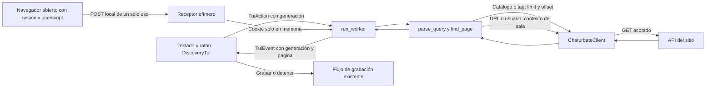

# Catálogo, búsqueda y sesión de la TUI

Análisis y corrección local del 2026-11-03. El alcance es el recorrido Inicio →
búsqueda → página → sala → grabación y la conexión de sesión del grabador.

## Evidencia de la web

Se descargaron el HTML inicial y sus 57 scripts públicos referenciados, unos
11,24 MB. El inventario con URL, tamaño y SHA256 está en
`/tmp/cbrec-web-discovery/manifest.json`; las observaciones de Chromium están en
`browser-observations.json` del mismo directorio. Son capturas locales, no código
incorporado al producto. No incluyen el backend privado ni garantizan que se hayan
descargado todos los módulos que la web puede cargar posteriormente.

Fuentes públicas inspeccionadas:

- [Prefetch del catálogo](https://web2.static.mmcdn.com/cachebust/roomlist-prefetch.c75990fe73dd.js): calcula `offset = (page - 1) * limit`; el tamaño predeterminado observado en este bundle es 90.
- [Cliente del catálogo y consultas relacionadas](https://web2.static.mmcdn.com/cachebust/5060-react-db51580c0d48368997a3.js): usa `/api/ts/roomlist/room-list/` también para salas en tendencia.
- [Construcción de parámetros](https://web2.static.mmcdn.com/cachebust/159-react-96af6aa911a6d5d2948b.js): transforma el estado de filtros y página en parámetros HTTP.

Tres GET sin cookies devolvieron: catálogo con `limit=20`, 21 entradas;
tag `gaming`, 20 entradas de un total de 39; y `offset=20`, 19 entradas.
Tardaron respectivamente 0,357, 0,351 y 0,307 segundos en ese ensayo.
No es un benchmark de rendimiento sostenido.

Chromium headless, con contexto nuevo y sin sesión personal, observó dos HTTP 400
y un HTTP 200 posterior al catálogo con `require_fingerprint`; este último
contenía 119 entradas. Se conserva el orden y las entradas del servidor, que puede
añadir promociones. No se promete un ranking estricto por espectadores ni el
mismo resultado personalizado de una cuenta autenticada.

El primer intento con Chrome DevTools MCP falló por falta de X server. La
observación posterior usó Playwright instalado y `/usr/bin/chromium` headless.
No se ejecutaron comentarios, follows, pagos ni endpoints que cambien la cuenta.

## Conexión entre nuestras capas



La TUI recibe eventos; no hace HTTP en el hilo que atiende teclado y ratón.
La generación evita que una respuesta encolada antigua sustituya la consulta
vigente. La tarea anterior se cancela al iniciar otra búsqueda. La consulta dura
como máximo ocho segundos; si falla, conserva filas, página y selección anteriores.
`R` repite la solicitud fallida. Las grabaciones mantienen su cancelación propia.

La búsqueda por URL extrae un nombre validado y consulta un endpoint fijo. No
descarga la URL pegada ni reenvía sus parámetros de seguimiento. Reutiliza la regla
de hosts de la aplicación. Se rechazan dominios ajenos, credenciales, puertos no
estándar y rutas que no representan un único perfil. Los tags anteriores siguen
aceptándose con o sin `#`; `@usuario` desambigua una consulta directa.

El catálogo y las miniaturas no reciben cookies. La sesión solo se usa en las
consultas de contexto que ya la admitían. Elegir un navegador orienta al usuario;
no detecta sus ventanas ni lee automáticamente su perfil. La sesión recibida no
se presenta como autenticación validada. Cancelar cierra el receptor pendiente y
conserva la sesión previa.

## Reglas y comprobaciones

| Regla | Resultado observable | Prueba |
|---|---|---|
| BR-001 · P1 | Inicio carga el catálogo; el CLI `discover` mantiene su JSON y límite | `home_is_a_search_deck_with_visible_actions`, regresiones de discovery |
| BR-002 · P1 | URL y `@usuario` consultan una sola sala sin recorrer páginas | `query_distinguishes_catalog_tags_and_profile_urls`, `direct_profile_query_uses_fixed_context_and_preserves_access_states` |
| BR-003 · P1 | PgUp/PgDn y botones cambian offset, muestran total y respetan primera/última página | `discovery_pages_follow_offsets_totals_and_keep_promoted_entries_without_cookies`, `paging_keeps_the_current_page_on_error_and_stops_at_the_end` |
| BR-004 · P1 | Una búsqueda nueva cancela la anterior; ocho segundos limitan una consulta atascada | `new_search_cancels_a_stalled_catalog_and_session_cancel_closes_the_receiver` |
| BR-005 · P1 | Un error conserva resultados; una respuesta antigua no termina la consulta vigente | `stale_page_cannot_finish_a_newer_search_and_retry_repeats_the_failed_request` |
| BR-006 · P1 | Pegar una URL no graba ni sale; el campo tiene límite | `pasted_url_does_not_trigger_shortcuts_and_new_search_can_replace_loading` |
| BR-007 · P1 | El asistente pide navegador y sesión abierta; se puede cancelar | `session_wizard_requires_browser_choice_and_supports_cancel`, regresión del receptor local |
| BR-008 · P0 | Navegar o salir no elimina grabaciones ni rompe la restauración del terminal | `tui_worker_cancels_recording_without_losing_bytes_or_sidecar`, QA PTY y gráfica |

## Verificación reproducible

```bash
cargo test --locked --workspace --all-targets --all-features -- --include-ignored
cargo clippy --locked --all-targets --all-features -- -D warnings
cargo fmt --check
cargo build --locked --bin cbrec --example tui_fixture
python scripts/test_tui_pty.py target/debug/cbrec
python scripts/test_tui_graphics.py target/debug/examples/tui_fixture /tmp/cbrec-tui-discovery-graphics
```

La prueba gráfica compara dos bitmaps de 480×270, navegación, zoom, resize y
restauración de Inicio en Konsole/Xvfb. La fixture no consulta la red ni graba.
Los contratos HTTP y la transferencia de sesión usan servidores y cookies
sintéticos. No acreditan acceso a una cuenta real, una grabación autenticada larga
ni gráficos nativos de Windows/macOS. El backend privado del sitio no fue auditado.


## Resultado del incremento

- PASS: suite local de producto (233 pruebas de biblioteca, 23 de argumentos y 16 de comportamiento) y 43 pruebas de ejemplos, sin omisiones en la ejecución completa Linux.
- PASS: Clippy con warnings como errores, formato y revisión de whitespace.
- PASS: QA gráfica Konsole/Xvfb con y sin `NO_COLOR`, 259200 píxeles comprobados; también se oculta la imagen al abrir el asistente y se restaura al cancelarlo.
- PASS: PTY del binario, URL con bracketed paste, selección del navegador, cancelación del receptor, clic, resize y restauración del terminal.
- PASS: ensayo de la TUI contra la API real, sin sesión ni grabaciones: Inicio 0,448 s, página siguiente 0,226 s, perfil por URL 0,460 s. Son tiempos de un único ensayo, no una garantía.

La cobertura final es **91,51 %** (9353/10221 líneas), superior al mínimo de CI
del 90 %. Se conserva en `/tmp/cbrec-tui-discovery-lcov.info`. El primer intento
falló porque dos wrappers locales forzaban LLVM 22, cuya biblioteca no está
instalada. Se ejecutó el binario real de cargo-llvm-cov con LLVM 23 ya disponible
en `/tmp/cbrec-llvm23`, sin modificar la configuración del equipo. La configuración
del CI sigue usando su instalación propia.

NO EJECUTADO en este incremento: gráficos de Windows/macOS, cuenta autenticada real
y grabación larga de esa cuenta. Los cambios se integran en `beta`; la publicación
de una release queda pendiente.
